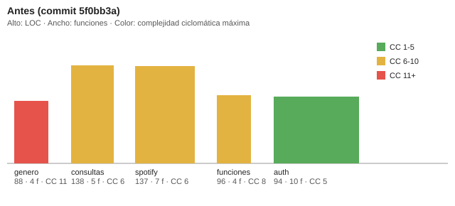
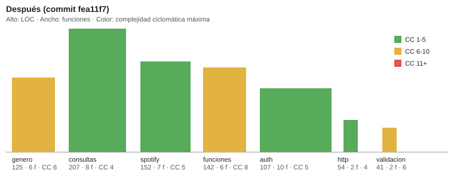

# Métricas del software — MusicTrack

Métricas de producto medidas sobre el código PHP propio, con las herramientas y la configuración
descritas en [EVALUACION_SOFTWARE.md](EVALUACION_SOFTWARE.md).

- **Antes:** commit `5f0bb3a`, último antes de la Guía 11.
- **Después:** commit `cf7cea2`, con las mejoras R1 a R7.

Ambas mediciones se hicieron con `tools/analizar.ps1` sobre una copia exportada con `git archive`,
con las mismas versiones y archivos de configuración. Los reportes originales están en
[`evidencias/antes`](evidencias/antes) y [`evidencias/despues`](evidencias/despues).

## 1. Métricas iniciales

| Métrica | Valor | Herramienta |
|---|---:|---|
| Archivos PHP | 33 | phploc |
| Líneas de código (LOC) | 1894 | phploc |
| Líneas de comentario (CLOC) | 103 (5,44 %) | phploc |
| Líneas sin comentarios (NCLOC) | 1791 | phploc |
| Líneas lógicas (LLOC) | 468 | phploc |
| Funciones | 32 | phploc |
| Largo promedio de función | 5 LLOC | phploc |
| Complejidad ciclomática promedio por función | 3,16 | PHPMD + `tools/polimetrica.php` |
| Complejidad ciclomática máxima | 11 (`detectar_genero`) | PHPMD |
| Complejidad por línea lógica | 0,45 | phploc |
| Duplicidad | 0,74 % (2 clones, 14 líneas) | phpcpd |
| Problemas de calidad | 88 | PHPStan nivel 6 |
| Problemas de diseño | 33 | PHPMD |
| Incumplimiento de estándares | 84 (78 errores, 6 advertencias) | PHP_CodeSniffer, PSR-12 |
| Posibles vulnerabilidades | 2 tipos, 13 puntos | Revisión manual |
| Deuda técnica estimada | 876 min (≈ 14,6 h) | Estimación (sección 5) |
| Pruebas aprobadas | 36 de 37 (97,3 %) | PHPUnit |

## 2. Métricas posteriores a la refactorización

| Métrica | Valor | Herramienta |
|---|---:|---|
| Archivos PHP | 35 | phploc |
| Líneas de código (LOC) | 2257 | phploc |
| Líneas de comentario (CLOC) | 293 (12,98 %) | phploc |
| Líneas sin comentarios (NCLOC) | 1964 | phploc |
| Líneas lógicas (LLOC) | 484 | phploc |
| Funciones | 43 | phploc |
| Largo promedio de función | 4 LLOC | phploc |
| Complejidad ciclomática promedio por función | 2,72 | PHPMD + `tools/polimetrica.php` |
| Complejidad ciclomática máxima | 8 (`url_biblioteca`) | PHPMD |
| Complejidad por línea lógica | 0,44 | phploc |
| Duplicidad | 0 % (sin clones) | phpcpd |
| Problemas de calidad | 0 | PHPStan nivel 6 |
| Problemas de diseño | 23 | PHPMD |
| Incumplimiento de estándares | 5 (1 error, 4 advertencias) | PHP_CodeSniffer, PSR-12 |
| Posibles vulnerabilidades | 2 puntos pendientes | Revisión manual |
| Deuda técnica estimada | 288 min (≈ 4,8 h) | Estimación (sección 5) |
| Pruebas aprobadas | 46 de 46 (100 %) | PHPUnit |

## 3. Tabla comparativa

| Métrica o indicador | Antes | Después | Variación |
|---|---:|---:|---:|
| Líneas de código (LOC) | 1894 | 2257 | +363 (+19,2 %) |
| — de ellas, comentarios y PHPDoc | 103 | 293 | +190 (+184 %) |
| — líneas lógicas (LLOC) | 468 | 484 | +16 (+3,4 %) |
| Cantidad de archivos | 33 | 35 | +2 |
| Funciones | 32 | 43 | +11 |
| Complejidad ciclomática máxima | 11 | 8 | −3 (−27 %) |
| Complejidad ciclomática promedio por función | 3,16 | 2,72 | −0,44 (−14 %) |
| Funciones con complejidad alta (11-20) | 1 | 0 | −1 |
| Funciones con complejidad moderada (6-10) | 4 | 3 | −1 |
| Porcentaje de duplicidad | 0,74 % | 0 % | −0,74 pp (−100 %) |
| Problemas de calidad (PHPStan) | 88 | 0 | −88 (−100 %) |
| Problemas de diseño (PHPMD) | 33 | 23 | −10 (−30 %) |
| Incumplimiento de estándares (PSR-12) | 84 | 5 | −79 (−94 %) |
| Posibles vulnerabilidades (puntos afectados) | 13 | 2 | −11 (−85 %) |
| Deuda técnica estimada | 876 min | 288 min | −588 min (−67 %) |
| Pruebas automatizadas aprobadas | 36/37 | 46/46 | +9 pruebas; 0 fallidas |

### Detalle por tipo de problema

| Herramienta y regla | Antes | Después | Qué lo cambió |
|---|---:|---:|---|
| phpcpd: clones | 2 | 0 | R1 |
| PHPStan `variable.undefined` (vistas) | 65 | 0 | R6: `@var` en cada vista |
| PHPStan `missingType.iterableValue` | 23 | 0 | R6: PHPDoc con la forma de los arreglos |
| PHPMD `CyclomaticComplexity` (> 10) | 1 | 0 | R3 |
| PHPMD `NPathComplexity` (> 200) | 1 | 0 | R3 |
| PHPMD `ShortVariable` | 14 | 7 | R2, R3 y R4 renombran `$f`, `$q`, `$id`, `$m`, `$n`, `$i` y quitan tres `$ch`; R2 agrega tres `$r` (respuesta HTTP) |
| PHPMD `MissingImport` | 5 | 4 | R2: menos `throw new RuntimeException` repetidos |
| PHPMD `ExitExpression` | 9 | 9 | No se intervino (ver [MANTENIMIENTO.md](MANTENIMIENTO.md)) |
| PHPMD `ShortMethodName` (`e`, `db`) | 2 | 2 | Se conservan a propósito |
| PHPMD `BooleanArgumentFlag` | 1 | 1 | No se intervino |
| PHPCS errores corregibles | 78 | 1 | R6 (`phpcbf`). Queda `registro.php`, ver nota |
| PHPCS largo de línea (> 120) | 4 | 0 | R6 |
| PHPCS PSR-1 *side effects* | 2 | 4 | Sube: ver interpretación |

## 4. Interpretación de las variaciones

**Las líneas de código subieron un 19 %, y es lo esperado.** Casi todo el aumento son comentarios y
PHPDoc (+190 líneas), que antes eran el 5,4 % del código y ahora son el 13 %. Las líneas lógicas, que
sí ejecutan algo, subieron solo un 3,4 % (+16). Ese poco se explica por las validaciones nuevas de R5
y las funciones extraídas en R3 y R4, cada una con su firma. Más líneas no significa peor código: hoy
el código es más fácil de leer y de analizar.

**Hay más funciones (32 → 43) y son más simples.** Al extraer funciones (R1, R2, R3 y R4), el largo
promedio bajó de 5 a 4 líneas lógicas y la complejidad promedio de 3,16 a 2,72. La complejidad
**total** subió un poco (101 → 117), porque se agregaron decisiones de validación que antes no
existían (R5). Es complejidad que protege al sistema, no complejidad accidental.

**Ninguna función pasa ya de complejidad 8.** `detectar_genero()` (11) y `mapear_genero()`
(10, NPath 384) eran las únicas en el límite o sobre él. Ahora la más compleja es `url_biblioteca()`
(8), que no se intervino porque su condición está concentrada en un solo filtro.

**La duplicidad bajó a 0 %.** El 0,74 % inicial era bajo, pero estaba en la regla de negocio más
importante: qué datos son válidos para una canción.

**PHPStan pasó de 88 a 0.** Los 65 avisos de las vistas no eran errores de ejecución: index.php sí
define esas variables. Eran una señal de diseño: nada documentaba qué recibe cada vista. Al
declararlas, PHPStan puede revisar las vistas y una persona nueva sabe qué datos llegan.

**Los incumplimientos de estándar bajaron de 84 a 5.** Los avisos PSR-1 *side effects* subieron de 2
a 4, porque `genero.php` y `spotify.php` ahora hacen `require_once` de `http.php`. Para PSR-1, incluir
un archivo es un efecto secundario. Se aceptó a cambio de quitar la duplicación de R2; la solución de
fondo es la carga automática con Composer.

**El error PSR-12 que queda está en `registro.php` (raíz):** falta una línea en blanco después de
`<?php`. Ese archivo no se modificó (ver [MANTENIMIENTO.md](MANTENIMIENTO.md)).

**Hay vulnerabilidades pendientes.** De los 12 puntos de entrada que fallaban con un arreglo, queda
`registro.php` (raíz). Además, los datos personales quitados en R7 siguen en el historial de Git
anterior al cambio.

**Diseño (PHPMD): −30 %.** Quedan sobre todo 9 `ExitExpression`, propias del modelo "una acción, una
redirección" sin framework. Eliminarlas implica rediseñar la capa de acceso al negocio, y eso se
propone como mantenimiento perfectivo.

## 5. Estimación de la deuda técnica

Ninguna de las herramientas usadas calcula la deuda técnica (SonarQube sí, pero no se usó; ver
[EVALUACION_SOFTWARE.md](EVALUACION_SOFTWARE.md)). Se estimó con el método de SonarQube (SQALE): a
cada problema se le asigna un tiempo de corrección y se suman los tiempos. Los tiempos son una
estimación del equipo, no un estándar.

| Tipo de problema | Minutos por caso | Antes | Min. antes | Después | Min. después |
|---|---:|---:|---:|---:|---:|
| PSR-12 corregible con `phpcbf` | 1 | 78 | 78 | 1 | 1 |
| Línea de más de 120 caracteres | 5 | 4 | 20 | 0 | 0 |
| PSR-1 *side effects* | 15 | 2 | 30 | 4 | 60 |
| PHPMD `ShortVariable` / `MissingImport` | 2 | 19 | 38 | 11 | 22 |
| PHPMD `ShortMethodName` | 5 | 2 | 10 | 2 | 10 |
| PHPMD `ExitExpression` | 15 | 9 | 135 | 9 | 135 |
| PHPMD `BooleanArgumentFlag` | 20 | 1 | 20 | 1 | 20 |
| PHPMD complejidad / NPath | 30 | 2 | 60 | 0 | 0 |
| PHPStan arreglo sin tipo | 5 | 23 | 115 | 0 | 0 |
| PHPStan variable sin declarar | 2 | 65 | 130 | 0 | 0 |
| Clon de código | 30 | 2 | 60 | 0 | 0 |
| Entrada que provoca error fatal | 10 | 12 | 120 | 1 | 10 |
| Datos personales en el repositorio | 30 | 1 | 30 | 1 (historial) | 30 |
| Defecto: confirma cambios no guardados | 30 | 1 | 30 | 0 | 0 |
| **Total** | | | **876 min (14,6 h)** | | **288 min (4,8 h)** |

## 6. Representación polimétrica

Cada componente se dibuja como un rectángulo:

- **Altura:** líneas de código (LOC), 1 px por línea.
- **Ancho:** cantidad de funciones, 12 px por función.
- **Color:** complejidad ciclomática **máxima** del archivo: verde de 1 a 5 (baja), amarillo de 6 a 10
  (moderada) y rojo de 11 en adelante (alta).

Los datos salen de [`tools/polimetrica.php`](../tools/polimetrica.php), que combina el conteo de líneas
y funciones con el reporte de complejidad de PHPMD. Por ejemplo:

```powershell
php tools\polimetrica.php . docs\evidencias\despues\complejidad.txt includes\genero.php includes\consultas.php
```

### Datos

| Componente | LOC antes | Funciones antes | CC máx. antes | LOC después | Funciones después | CC máx. después |
|---|---:|---:|---:|---:|---:|---:|
| `includes/genero.php` | 88 | 4 | **11** | 125 | 6 | 6 |
| `includes/consultas.php` | 138 | 5 | 6 | 207 | 8 | 4 |
| `includes/spotify.php` | 137 | 7 | 6 | 152 | 7 | 5 |
| `includes/funciones.php` | 96 | 4 | 8 | 142 | 6 | 8 |
| `includes/auth.php` | 94 | 10 | 5 | 107 | 10 | 5 |
| `includes/http.php` (nuevo) | — | — | — | 54 | 2 | 4 |
| `includes/validacion.php` (nuevo) | — | — | — | 41 | 2 | 6 |

### Antes (commit `5f0bb3a`)



### Después (commit `cf7cea2`)



### Lectura de la vista polimétrica

- **`genero.php`** era el único rectángulo rojo: estrecho (pocas funciones) y muy complejo para su
  tamaño. Después de R3 es más ancho (6 funciones) y pasa a amarillo. Está más repartido, aunque
  tiene más líneas por los PHPDoc.
- **`consultas.php`** creció en altura y en ancho al extraer `condicion_busqueda()`, `filtro_biblioteca()`
  y `paginar()` (R4), y pasó de amarillo a verde. Es el archivo más alto y el próximo candidato a
  dividirse (por ejemplo, biblioteca y estadísticas por separado).
- **`spotify.php`** mantiene sus 7 funciones y pasa a verde: R2 sacó el código de red a `http.php`,
  que es pequeño y verde.
- **`funciones.php`** sigue en amarillo por `url_biblioteca()` (8), el próximo punto a simplificar.
- **`auth.php`** es el más ancho (10 funciones cortas) y siempre fue verde: es el ejemplo de un
  componente cohesionado.

## 7. Conclusiones sobre la calidad del código

1. **El código ya era razonablemente sano** (duplicidad < 1 %, complejidad promedio 3,16), pero tenía
   **defectos que las métricas no muestran**: una respuesta "Cambios guardados" sin guardar, errores
   fatales con entradas manipuladas y datos personales en el repositorio. Las pruebas y la revisión
   manual los encontraron, y fueron las mejoras de mayor impacto.
2. **Mantenibilidad:** sin duplicidad, sin funciones de complejidad alta, PHPStan en 0 y PSR-12 casi
   completo. Las reglas de validación, el acceso HTTP y el mapeo de géneros tienen ahora un solo lugar.
3. **Verificabilidad:** el proyecto pasó de no tener pruebas a 46 automatizadas (unitarias, de
   integración con MySQL/MariaDB, funcionales por HTTP y de integración con Deezer y Spotify).
4. **La métrica que sube no siempre empeora.** Las LOC aumentaron por documentación, y la complejidad
   total por validaciones necesarias. Hay que leerlas junto con la complejidad promedio y máxima.
5. **Deuda pendiente:** unas 4,8 h estimadas, concentradas en el modelo de redirección con `exit` y la
   falta de carga automática de clases, que dependen de un cambio de arquitectura (ver
   [MANTENIMIENTO.md](MANTENIMIENTO.md)).
